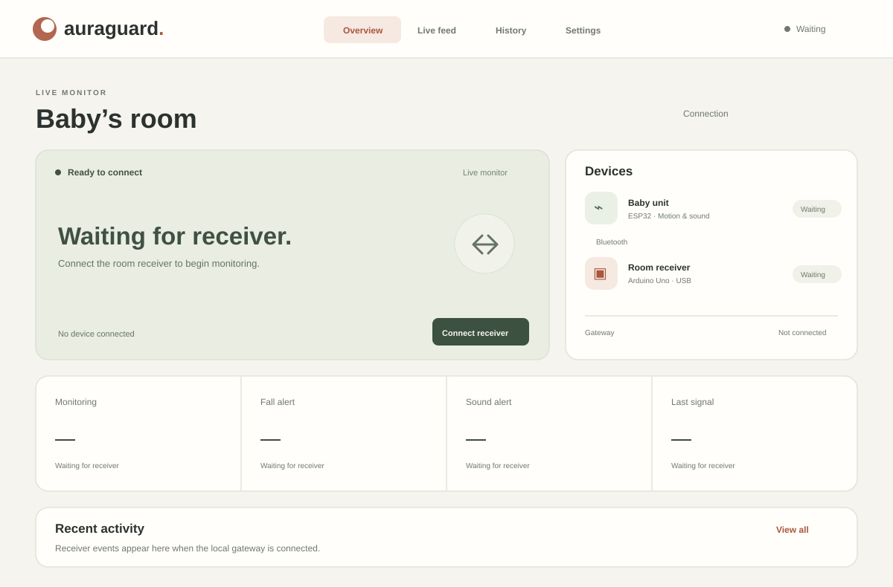
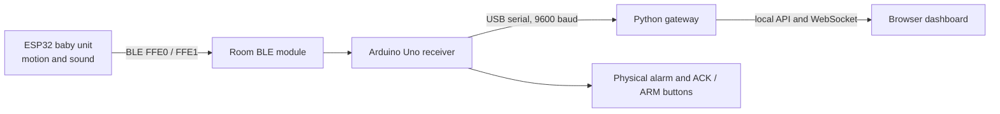

# AuraGuard

A live dashboard for the supplied ESP32 baby unit and Arduino Uno room receiver. The Python gateway reads the Uno's **9600-baud USB status and alert logs**; the browser shows receiver state, baby-link age, reported alerts, physical-button actions, and event history.



*Interface preview reconstructed from the included dashboard. It depicts the waiting state, not a live receiver screenshot. See [screenshots and capture notes](docs/SCREENSHOTS.md).*

**Start with [the lab setup guide](docs/LAB_SETUP.md).** The existing firmware does not need a protocol patch for this parser. Both supplied sketches are included unchanged.

## At a glance

| Area | What it provides |
| --- | --- |
| Overview | Receiver and baby-link status, alert summary, and recent activity. |
| Live feed | Current receiver state, session counters, and latest USB log line. |
| History | Searchable and filtered receiver events with CSV export. |
| Settings | Connection guidance, room name, time format, theme, and optional in-browser alert sound. |

The interface reports what the **room receiver** actually logged. It does not make an independent medical or safety assessment, and a cleared receiver flag does not establish that an incident has ended.

## Run locally

Use Python 3.10 or newer. Run from the extracted project folder. Connect the **room Uno** to the computer by USB, and close Arduino Serial Monitor or any Arduino CLI monitor using that port.

```bash
python -m pip install -r server/requirements.txt
python server/app.py --list-ports
python server/app.py --port COM4 --baud 9600 --protocol uno-room-v1
```

Replace `COM4` with the listed Uno port, then open **http://127.0.0.1:8000**. On Windows, use `py` if that is your Python launcher; on Linux/macOS, use `python3` if required. The lab guide includes virtual-environment commands.

The final dashboard uses `uno-room-v1`, the default server profile. It displays live hardware data only. Without the local gateway and a connected Uno, it remains waiting or disconnected. The hosted page cannot access the computer's USB port; use the locally served page for the lab.

## Live docs page

The same gateway serves a live documentation page at **http://127.0.0.1:8000/docs**: pitch deck, architecture and data flow, on-device AI model cards read from the shipped weight files, live receiver counters and events, the running server's own API table, tech-doc links, and the team roster. Manage it at `/docs/admin` (admin token in `server/data/docs-config.json`, or set the `AURAGUARD_DOCS_TOKEN` environment variable to choose the token — required for hosted deploys where the filesystem is ephemeral): toggle public visibility on/off, schedule an availability window, edit every pitch section, and add team members with auto-resized photos. Everything on the page is assembled per request from the running server and the on-disk config — nothing is a static screenshot.

## Connected hardware

**ESP32 + MPU6050 + sound sensor → BLE room module → Uno → USB serial at 9600 baud → Python gateway → browser.**



The baby ESP32 is a BLE client using service `FFE0` and characteristic `FFE1`. It sends `OK`, `FALL`, and `CRY` to the room module. The Uno consumes those messages and prints its own logs; it does **not** forward every raw `OK` or `CRY` to USB. Both sensors are on the ESP32 with the supplied configuration (`LOCAL_MIC = false` on the Uno).

## AI baby unit

An AI firmware pair, [`esp32_baby_unit_ai`](firmware/esp32_baby_unit_ai/) and [`uno_room_receiver_ai`](firmware/uno_room_receiver_ai/), upgrades the baby unit's decisions while keeping this exact wiring, BLE route, and dashboard contract:

- **Sound:** an on-device cry classifier (2 kHz burst sampling, spectral band-share and envelope features, softmax model) decides whether a loud sound is actually the baby, rejecting knocks, TV hiss, fans, and appliance tones before `CRY` is sent.
- **Movement:** a 3-class motion classifier reads the MPU6050's gyroscope (unused by the supplied sketch) alongside acceleration to tell a real fall from play/running. AI-confirmed falls alert immediately; play-like triggers are vetoed; uncertain windows fall back to the supplied stillness gate, so the AI can never silence a real fall pattern.
- **Bluetooth range:** the baby unit polls its link RSSI and, after 8+ seconds at the range limit, sends `WANDER` — a warning *before* the link drops. The AI receiver prints wander log lines that the gateway turns into dashboard events.
- **Plus:** sensor fusion with alert priorities, background activity recognition (sleeping vs up and playing), and the supplied v5 fault-recovery behavior throughout.

Models train offline in pure-stdlib Python ([`server/ai`](server/ai/)) and export to the firmware as a C header. See [docs/AI.md](docs/AI.md) for the pipeline, retraining, and verification, including a host-compiled cross-check that proves the firmware math matches the Python reference.

| Dashboard item | Source and meaning |
| --- | --- |
| Room connection | Serial-port connection and fresh receiver logs. |
| Armed state | Receiver startup, physical ARM log, and periodic status. |
| Baby link | Receiver `baby` and `lastMsg` status, plus explicit link-loss/restoration logs. |
| Possible-fall report | Receiver fall alert. The baby firmware can produce it from its detector, sensor-fault fallback, or BOOT test button. |
| Sound alert | Receiver `cry` flag and its sound-start/end logs. |
| Acknowledgment / mute | Physical ACK log. ACK clears the receiver fall flag and starts 15 seconds of muting. |
| Event history | Observed receiver events with gateway receipt timestamps. |

There are no raw acceleration, sound-level, gyro, battery, or sensor-health readings in these USB logs. The receiver also never reads PC commands from `Serial`, so alarm control stays on the physical ACK and ARM switches.

If the gateway attaches mid-session, periodic status cannot reveal the existing fall flag or mute timer. Fall remains unknown until a startup, ARM, ACK, or fall event establishes it. A mute countdown appears only when the gateway observes ACK. See [the protocol](docs/PROTOCOL.md) for exact state rules.

## Physical controls

- **ACK, Uno pin 9:** clears the fall flag, mutes alarm outputs for 15 seconds, and sends `ACK` to the baby. It leaves sound and link-loss flags unchanged.
- **ARM, Uno pin 10:** toggles armed state and clears fall, sound, and link-loss flags. It leaves an existing mute timer unchanged.
- **BOOT, ESP32:** sends a hardware test `FALL` when linked and activates the real receiver alarm path.

The receiver clears its sound flag after more than 2.5 seconds without another `CRY`, and checks for link loss after more than 6 seconds without a baby message while armed and after at least one message has been seen. A cleared receiver flag does not establish that a physical incident was resolved.

## Files

| Path | Purpose |
| --- | --- |
| `docs/LAB_SETUP.md` | Setup, expected logs, physical checks, and troubleshooting. |
| `docs/PROTOCOL.md` | Exact Uno USB protocol, API state, and advanced profile appendices. |
| `docs/BABY_BLE_V5.md` | Supplied baby firmware's transport and detector behavior. |
| `docs/AI.md` | AI layer: classifiers, features, training, and verification. |
| `docs/SCREENSHOTS.md` | Visual tour and instructions for capturing real hardware screenshots. |
| `docs/screenshots/overview-preview.svg` | Labeled illustration of the disconnected dashboard layout. |
| `firmware/esp32_baby_unit_ble_v5/esp32_baby_unit_ble_v5.ino` | Unchanged supplied baby sketch. |
| `firmware/uno_room_receiver_cry/uno_room_receiver_cry.ino` | Unchanged supplied room-receiver sketch. |
| `firmware/esp32_baby_unit_ai/` | AI baby sketch: cry/fall-vs-play/range inference on-device (drop-in replacement). |
| `firmware/uno_room_receiver_ai/` | Receiver variant that understands the AI baby unit's `WANDER` message. |
| `firmware/tests/host_ai/` | Host-compiled cross-check of the sketch's AI math against Python. |
| `firmware/README.md` | Supplied wiring/settings and separate legacy reference notes. |
| `server/` | Local serial gateway, API, persistence, AI pipeline (`server/ai/`), and tests. |
| `server/docs_module.py`, `server/docs_static/` | Live `/docs` page: visibility-gated pitch deck, tech docs, and token-protected admin panel. |
| `dist/` | Browser app and bundled assets. |

## Storage and verification

The default live database is `server/data/auraguard-uno-room-v1-live.sqlite3`. Use `--db path/to/session.sqlite3` to choose a different session. Event timestamps are gateway receipt times; receiver counters count observed events, not exact ESP32 heartbeat totals. Losing a connection does not generate substitute readings.

Local SQLite databases, logs, Python caches, and virtual environments are ignored by Git. Review screenshots before sharing them because room names, serial-port paths, timestamps, and events may identify a lab session.

Run one server process for the Uno port. The server binds to `127.0.0.1`; HTTP/WebSocket traffic stays on the local server. The firmware's physical controls continue to operate independently of the browser.

```bash
python -m pip install -r server/requirements-test.txt
python -m unittest discover -s server -p "test_*.py" -v
```

With Node.js installed, check receiver snapshots against the dashboard's live-state rules:

```bash
node server/test_receiver_ui.cjs
```

The supplied sketches were inspected and copied unchanged; they have not been board-compiled or flashed in this environment. Validate the link and alarm path on the lab fixture. The included C++ tests exercise the separate generated legacy firmware, not these supplied sketches.

## Advanced reference integrations

`baby-ble-v5` and `json-v1` remain explicit API/reference integrations. The final lab dashboard expects `uno-room-v1`. The older Classic SPP reference sketches use a different radio/data protocol and are not replacements for either supplied sketch. Their contracts and controls are documented separately in [the protocol appendix](docs/PROTOCOL.md) and [firmware guide](firmware/README.md).

## Design references and credits

The interface is an original implementation informed by these public visual references; no licensed templates were imported:

- [Nara Baby by Everyday Industries](https://everydayindustries.com/casestudy/mobile-app-ui-design-case-study/) for clear, parent-focused activity and history screens.
- [Untitled UI sales dashboard by Jordan Hughes](https://dribbble.com/shots/21695116-Sales-dashboard-Untitled-UI) for dashboard spacing and information hierarchy.
- [Catalyst application layouts by Tailwind Labs](https://tailwindcss.com/blog/2024-05-24-catalyst-application-layouts) for horizontal application navigation and responsive layout structure.

Interface icons are from [Lucide](https://lucide.dev) (ISC License, © Lucide Contributors), including `baby` for the baby unit and `radio-receiver` for the room receiver. Manrope is bundled locally with its [SIL Open Font License](dist/assets/OFL-Manrope.txt), so the interface does not need a remote font request.

## Technical references

- [Espressif BLE API](https://docs.espressif.com/projects/arduino-esp32/en/latest/api/ble.html)
- [pySerial port and timeout behavior](https://pyserial.readthedocs.io/en/latest/shortintro.html)
- [FastAPI WebSockets](https://fastapi.tiangolo.com/advanced/websockets/)
