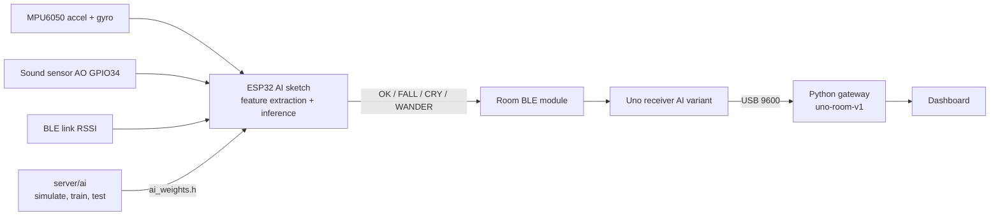

# AuraGuard AI layer

The AI build of the baby unit answers three questions on-device, inside the
nursery, with no cloud round-trip:

1. **Is that sound actually the baby?** A cry classifier runs on the sound
   sensor's analog output.
2. **Was that a fall, or is the baby just running around?** A motion
   classifier runs on MPU6050 acceleration *and* gyroscope data (the supplied
   v5 sketch never reads the gyro).
3. **Is the baby still within Bluetooth range?** A proximity tracker polls
   the link RSSI and raises a WANDER warning *before* the link drops.

A fusion layer combines them into one alert state with priorities
`FALL > SENSOR_FAULT > WANDER > CRY > activity > OK`
([`server/ai/fusion.py`](../server/ai/fusion.py), mirrored in the sketch).

## Where the AI runs



Inference happens on the ESP32; the room-side message contract stays text
lines, so the existing gateway and dashboard work unchanged. Training happens
offline in Python. Both sides share one feature definition:
[`server/ai/features.py`](../server/ai/features.py) is the reference, the
sketch is a line-for-line C port, and a host-compiled cross-check
(`firmware/tests/host_ai`) proves they agree.

## Models

Small softmax (multinomial logistic) classifiers on hand-designed physics
features. They train in seconds with the Python standard library only, run in
microseconds on the ESP32 with no TFLite dependency, and stay inspectable —
every weight is in `server/ai/weights/*.json` and `firmware/esp32_baby_unit_ai/ai_weights.h`.

### Cry classifier (2 classes: other / cry)

- **Input:** 8 bursts × 128 ADC samples at 2 kHz, spaced 200 ms apart (1.6 s
  observation). Bursts are captured only while the room is loud, and never
  while a fall candidate is pending, so audio analysis cannot starve the
  motion path.
- **Features (9):** burst RMS mean, max peak-to-peak, zero-crossing rate,
  Goertzel band shares for 78–250 Hz (fan/hum), 266–531 Hz (cry fundamental),
  547–984 Hz (harmonics), envelope modulation, envelope depth, and loud-duty.
  The band shares separate a cry's harmonic stack from broadband hiss; the
  envelope features separate its rhythmic bursts from steady appliance tones
  and sparse knocks.
- **Decision:** `p(cry) ≥ 0.65`, sustained with the v5 loud/quiet timing
  rules, before `CRY` is sent (once per second, as before).

### Motion classifier (3 classes: normal / active / fall)

- **Input:** 100 samples at 50 Hz (2 s) of 3-axis acceleration and 3-axis
  gyroscope, always flowing through a ring buffer.
- **Features (11):** magnitude mean/std/max/min, free-fall fraction
  (`|a| < 0.5 g`), jerk RMS, gyro mean/max, post-impact stillness std,
  tilt change between the window's first and last 0.5 s, and a periodicity
  (zero-crossing) measure that captures running's rhythm.
- **Decision (safety-first gate):** the proven v5 temporal detector still
  triggers on impact/free-fall. At the stillness check the classifier votes:
  - `p(fall) ≥ 0.55` → send `FALL` immediately;
  - `p(active) ≥ 0.60` → **veto** (it looked like play/running, *doura douri*);
  - otherwise the v5 impact-then-stillness gate decides, so a classifier
    misfire can never silence a real fall pattern. The sensor-loss fallback
    (`ALERT_ON_SENSOR_LOSS`) is untouched.
- The classifier also runs once per second in the background for activity
  recognition (sleeping vs up and playing), printed on the baby unit's USB
  status line.

### Bluetooth range (no learned model — signal physics)

- The ESP32 is the BLE central and polls `BLEClient::getRssi()` every 500 ms.
- EMA smoothing (τ = 2.5 s), 3 dB hysteresis, zones **near** (≥ −58 dBm),
  **edge** (−58…−70), **far** (< −70), **lost**.
- 8+ seconds sustained **far** → `WANDER` every 2 s. This fires before the
  receiver's 6 s no-message link-loss alarm, warning that the baby is about
  to leave range rather than reporting it after the fact. Tune `RSSI_NEAR` /
  `RSSI_FAR` for the actual module and room.

## Training and retraining

```bash
python -m server.ai.train --n 600 --seed 7
```

writes `server/ai/weights/motion.json`, `server/ai/weights/cry.json`, and
regenerates `firmware/esp32_baby_unit_ai/ai_weights.h`.

Training data currently comes from the physics-based simulator in
[`server/ai/simulate.py`](../server/ai/simulate.py) (random-orientation
gravity, free-fall collapse, impact spikes, post-fall tilt; cry harmonics
with amplitude modulation and vibrato against hiss/knock/tone/fan
impostors). **Replace or augment those windows with real nursery captures
when available** — keep the feature functions unchanged and the firmware
needs no edit. Simulator-trained weights are a starting point, not a medical
certification; validate on the lab fixture as with any detector.

## Verification

| Check | Command | What it proves |
| --- | --- | --- |
| AI unit tests | `python -m unittest server.test_ai -v` | Feature contracts, classifier accuracy on fresh simulator seeds (motion ≥ 95%, cry ≥ 90%, running-as-fall ≤ 2%), proximity zones/hysteresis/wander timer, fusion priorities, shipped-weight validity. |
| Gateway wander tests | `python -m unittest server.test_receiver_wander -v` | The new receiver log lines parse, set state, and emit events. |
| Full server suite | `python -m unittest discover -s server -p "test_*.py"` | Nothing in the existing gateway regressed. |
| Dashboard contract | `node server/test_receiver_ui.cjs` | Snapshot shape unchanged for the UI. |
| Firmware cross-check | see below | The C port's probabilities match Python on shared vectors, and the compiled fall gate sends FALL for falls and vetoes running. |

Firmware host cross-check (requires g++, no Arduino needed):

```bash
python firmware/tests/host_ai/gen_vectors.py
g++ -x c++ -std=c++17 -I firmware/tests/host_ai -I firmware/esp32_baby_unit_ai \
    -include Arduino.h -o firmware/tests/host_ai/host_test \
    firmware/esp32_baby_unit_ai/esp32_baby_unit_ai.ino firmware/tests/host_ai/main.cpp
./firmware/tests/host_ai/host_test firmware/tests/host_ai
```

The sketch itself has not been board-compiled or flashed in this environment
(same caveat as the supplied sketches). Paste any compiler error back.

## Room-side integration

- `firmware/esp32_baby_unit_ai/` — AI baby unit (drop-in replacement for the
  v5 sketch; same wiring and BLE route).
- `firmware/uno_room_receiver_ai/` — receiver variant that understands
  `WANDER` (yellow slow blink + low beep, below FALL/LINK-LOST/CRY in
  priority). The **supplied receiver still works**: it prints
  `unknown msg: WANDER`, which the gateway logs as an unknown-message
  warning — informative but noisy, so pair the AI baby unit with the AI
  receiver.
- The gateway (`--protocol uno-room-v1`) accepts the two new receiver log
  lines (`!!! WANDER - baby near Bluetooth range limit !!!`, `wander
  cleared`), exposes `receiver.wander_active` and a `wander_reports` counter
  in the snapshot, and emits warning/info events. The dashboard profile
  ignores unknown keys, so the shipped UI is unaffected; the events appear in
  History immediately.
