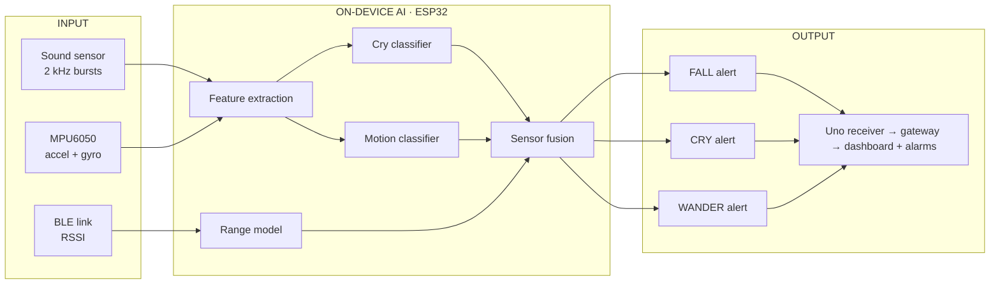

# AuraGuard — pitch in three points

Companion text for `auraguard-pitch.mp4` (render it with `render_pitch.py`).

## 1. Clear problem and user definition

**Problem.** Cheap baby monitors cry wolf. Any loud sound becomes "crying" —
a knock, the TV, a fan. Any jolt becomes a "fall" — including a baby who is
just running around. And you only learn the baby wandered too far when the
Bluetooth link is already dead. The result is alarm fatigue: parents stop
trusting the monitor precisely when it matters.

**Users.** Parents and caregivers of infants (0–24 months) who run this
DIY ESP32 + Arduino room monitor in a nursery, and who need three answers
they can trust — *is that sound really my baby, was that really a fall, is
my baby still in range* — privately, on-device, with no cloud and no
subscription.

## 2. AI-native approach

Not a wrapper around a cloud API: the intelligence *is* the product, and it
runs where the data is born — on the ESP32 itself.

| Model | Input | What it learns to answer | Held-out accuracy |
| --- | --- | --- | --- |
| **Cry classifier** | Sound sensor, 2 kHz bursts | Baby cry vs knocks, TV hiss, fan hum, appliance tones | 99% |
| **Motion classifier** | MPU6050 acceleration **+ gyroscope** | Real fall vs play/running vs normal | 100% (running-as-fall ≤ 2%) |
| **Range model** | BLE link RSSI | Near / edge / far / lost + 8 s pre-warning | physics-based |
| **Fusion** | all three | One alert state: `FALL > SENSOR_FAULT > WANDER > CRY`, with an AI veto for play-like triggers | — |

How it's built: physics-based feature engineering (Goertzel band shares
around the 300–500 Hz cry fundamental, free-fall fraction, gyro energy,
post-impact stillness, tilt change), tiny softmax classifiers trained
offline in pure-stdlib Python, exported as a C header, and a safety-first
fusion layer that can never let a model misfire silence a real fall
pattern. Retrainable with real nursery captures — privacy never leaves the
room.

## 3. Basic system flow (input → AI → output)

Raw sensors in → trustworthy alerts out, in milliseconds, entirely inside
the nursery. The existing OK/FALL/CRY room protocol, gateway, and dashboard
work unchanged — the AI only makes every alert mean what it says.
